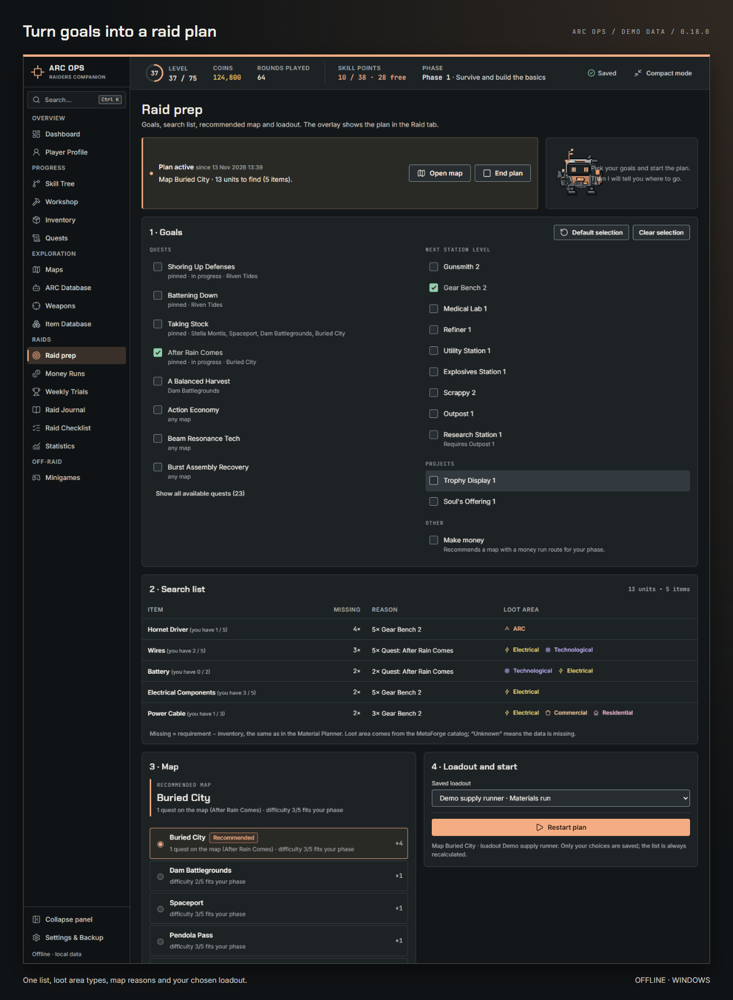
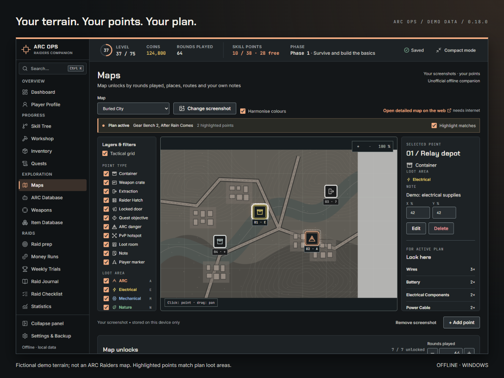
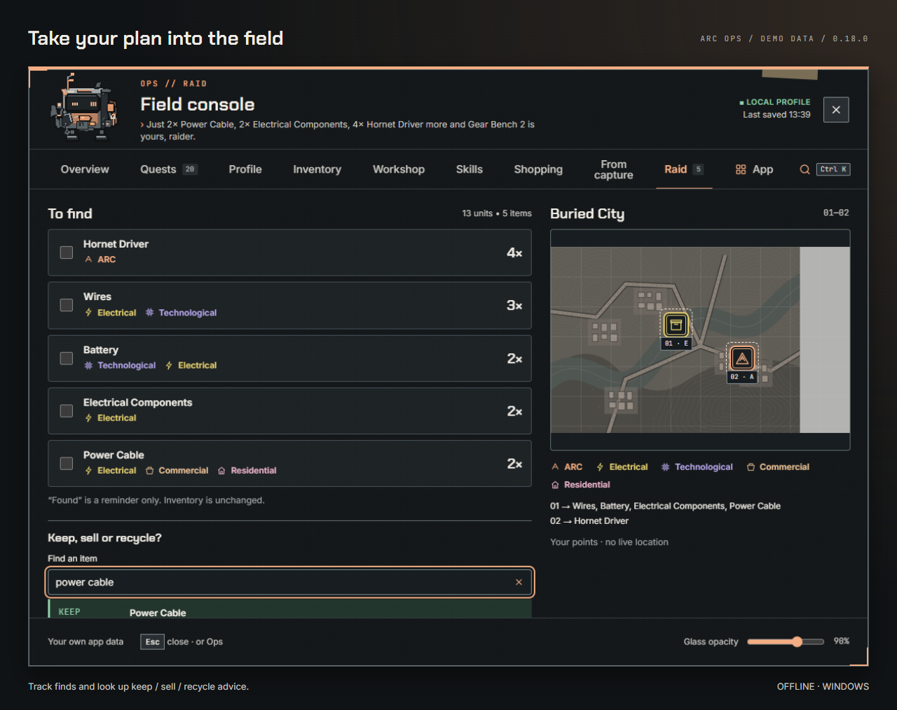
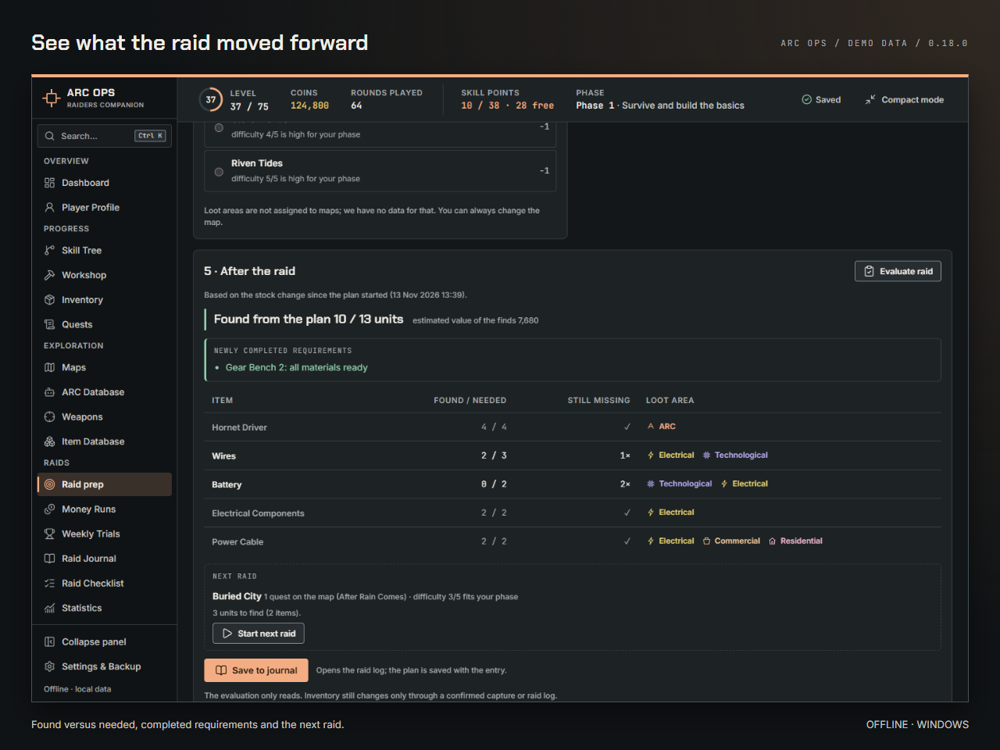
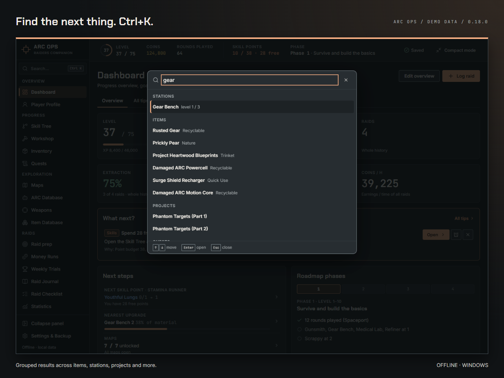
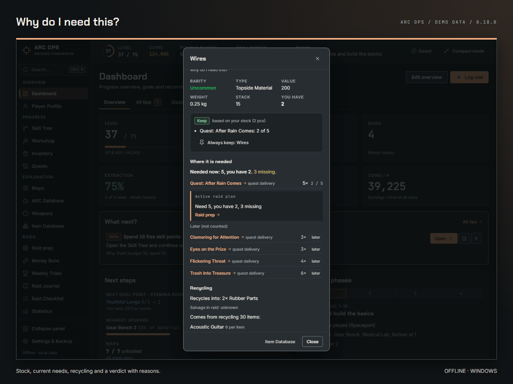
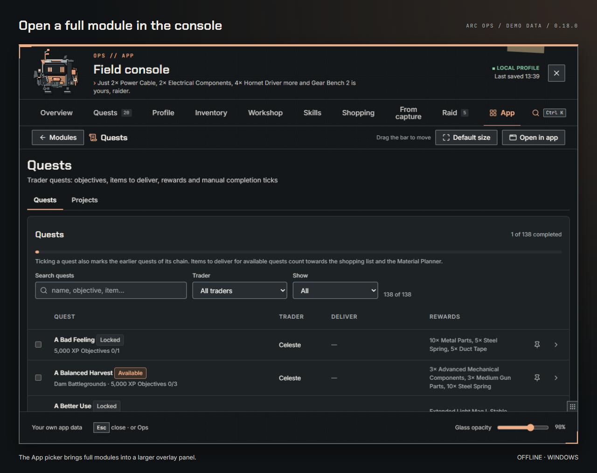

<picture>
  <source media="(prefers-color-scheme: light)" srcset="docs/assets/github/hero-light.png">
  
</picture>

# ARC Raiders Companion

[English](README.md) · [Instalace](#instalace) · [Historie verzí](CHANGELOG.md) · [Vývoj](DEVELOPMENT.md)

**0.22.1 · Windows · Offline · MIT · Česky a anglicky**

Osobní operační centrum pro hráče ARC Raiders. Zásoba, vylepšení dílny, cíle úkolů a plány skillů na jednom místě. To nejdůležitější si nech v kompaktním okně nebo ve volitelné polní konzoli Opse. Údaje ze snímků se čtou lokálně a před zápisem je vždy zkontroluješ. Mezi raidy si odpočiň u miniher s Bedňákem. Bez přihlášení, předplatného a cloudové synchronizace.

**Neoficiální fanouškovský projekt. Není spojen s Embark Studios ani jím schválen.**

## Co umí

Všechny obrázky ukazují demo data z prohlížečového sestavení, bez herních snímků. Nativní okna, zkratky a efekty Windows se v prohlížeči liší.

| Plánování a postup | Po ruce |
|---|---|
| **Přehled:** profil, další kroky, dílna a nákupní seznam. | **Kompakt:** připnuté úkoly, mám/potřebuji, rychlé akce. |
|  |  |
| **Úkoly:** ruční cíle a projekty; všechny cíle hotové neznamená automaticky splněný úkol. | **Buildy:** 12 plánů, vlastní buildy a porovnání se stromem; teorie je označená. |
|  |  |
| **Revize snímků:** jistota údajů, výslovné potvrzení, snímek stavu před zápisem. | **Minihry:** Stash Tetris, recyklační kvíz, Opsův hack, rozehraná kola a kosmetické nátěry. |
|  |  |

**Příprava na raid a vlastní mapa.** Vybereš cíle (úkoly, další úroveň stanice, projekt, peníze) a dostaneš jeden seznam toho, co chybí, s typem místa z katalogu předmětů, doporučenou mapu s důvody a plán v záložce Raid v konzoli včetně rady nechat / prodat / recyklovat. Interaktivní mapa stojí na snímku herní mapy, který si vložíš sám; aplikace žádné herní mapy nepřibaluje. Nad ním jsou tvoje body a zvýraznění podle plánu. Po raidu se plán porovná s nálezem (z potvrzeného snímku FINDINGS nebo ze změny zásoby): co ještě chybí, která vylepšení jsou připravená, doporučení dalšího raidu a uložení do deníku raidů; statistika pak ukáže, které mapy ti s cíli pomáhají.

| Aktivní plán: cíle, materiály a důvody výběru mapy | Interaktivní mapa: vlastní body a zvýraznění plánu |
|---|---|
|  |  |

Podklad na obrázku je smyšlená grafika projektu zastupující hráčův vlastní snímek. Nejde o herní ani komunitní mapu. Mapu a loadout si vybíráš sám.

| Záložka Raid: nálezy a rady k předmětům | Po raidu: nalezeno, chybí a připravené vylepšení |
|---|---|
|  |  |

Historie plánů patří k záznamům v deníku raidů. Statistika ukazuje, které mapy pomáhají s cíli; méně než tři plánované raidy označí jako „málo dat“.

### Co dál?

Karta **Co dál?** na Dashboardu seřadí další nejlepší kroky z tvých dat: vylepšení, které jde postavit, raid k vyhodnocení, připnutý úkol připravený k odevzdání, volné skill body, nedokončené Weekly Trials, plnou bednu, starou zálohu nebo cíl s blížícím se termínem. Každý tip říká proč, jedním klikem otevře správný modul a jde skrýt, dokud se jeho podmínka nezmění, nebo odložit o den. Nejdůležitější tip je i v kompaktním okně a v polní konzoli a Ops ho řekne ve zvolené povaze, když s nimi pracuješ, nikdy nad hrou.

### Hledat všude a „Proč to potřebuju?“

**Ctrl+K** (nebo pole v postranním panelu) najde předmět, úkol, stanici, skill, build, mapu, modul, sekci nastavení nebo tip, česky i anglicky, bez ohledu na diakritiku a drobné překlepy. Předmět otevře svou kartu: vzácnost, hodnotu, hmotnost a stack, tvoji zásobu, kde je potřeba (úkoly, stanice, projekty, tvoje cíle, aktivní plán raidu) a kolik ještě chybí, co z něj recyklací vznikne a z čeho vzniká on, kde ho hledat a které tvoje body na mapě sedí, a radu nechat / recyklovat / prodat i s důvodem. Stejnou kartu otevřou názvy předmětů v celé aplikaci, v hlavním okně i v polní konzoli.

| Ctrl+K: výsledky ve skupinách | Karta předmětu: proč ho potřebuješ |
|---|---|
|  |  |

Ctrl+K funguje při fokusu aplikace nebo konzole; je to zkratka daného okna. Karta ukazuje i odpovídající vlastní body na mapě. Chybějící údaje katalogu zůstávají neznámé.

### Bedňák / Ops

Volitelný pixelový buddy s podobami podle levelu, animacemi, nátěry a třemi povahami. Kliknutím otevřeš konzoli s profilem, úkoly, zásobou, dílnou, skilly, nákupy a revizí snímku a aktivním plánem raidu. Tlačítko **Aplikace** otevře nad hrou ve větším panelu kterýkoli plný modul (skill tree, recepty, databázi předmětů, mapy, deník, statistiky, minihry…); nastavení a zálohy zůstávají v hlavním okně. Výchozí stav buddyho je **vypnuto**.

**Ops tě nikdy nevyhodí ze hry (0.22.1).** Když je hra v popředí, Ops propouští každý klik do hry a nikdy jí nevezme fokus (Nastavení → Buddy a zkratka → „Buddy propouští kliky do hry (doporučeno)“, výchozí zapnuto). Během hry používáš zkratky: zkratku snímku a zkratku Úprav widgetů. Na ploše nebo s oknem aplikace v popředí jde na Opse kliknout a přetáhnout ho jako dřív.

**Odkud je každá hodnota.** Malá tečka vedle počtu v zásobě, pole profilu, úrovně stanice, ranku skillu nebo cíle úkolu po najetí myší ukáže původ: ručně, ze snímku (soubor nebo zkratka), z automatického snímání nebo z importu zálohy, kdy, s jakou jistotou rozpoznání a jestli jsi hodnotu potvrdil. Nastavení → Původ dat to shrne po oblastech i s posledními zápisy a karta předmětu má řádek „Původ“. Když se zásoba přes týden nezměnila a máš otevřené cíle, „Co dál?“ navrhne snímek STASH.

**Automatické snímání obrazovek mimo raid (volitelné, výchozí vypnuto, čeká na ověření u Embarku).** Když ho v Nastavení zapneš (po krátkém vysvětlení), Ops hlídá jen při hře v popředí: asi každé 2 s zkopíruje malý pruh s nadpisem obrazovky a teprve u známé obrazovky menu (příprava loadoutu, výsledek raidu a obrazovky, které vybereš) pořídí jeden plný snímek. Snímky zůstávají jen v paměti a po přečtení se zahodí. Z loadoutu a výsledku připraví zápis do Deníku raidů: jisté údaje zapíše se snímkem stavu a tlačítkem Zpět, nejisté čekají ve frontě „Ke kontrole“. Pozastavit jde v kompaktním okně i v nabídce ikony v oznamovací oblasti a „Vypnout všechna napojení na hru“ vypne najednou buddyho nad hrou, zkratku snímku i automatické snímání. Exkluzivní celá obrazovka může dávat černé snímky, doporučený je režim okna bez okraje. Zapínáš na vlastní uvážení.

**Widgety nad hrou (0.22.0, volitelné, výchozí vypnuto, čeká na ověření u Embarku).** Vyber si malé karty s vlastními daty a rozmísti je nad hru: Seznam k nalezení (plán raidu), Připnuté úkoly, Nákupy, Co dál?, Nechat / prodat / recyklovat, Obsazenost skrýše, Týdenní výzvy, Ops, Ke kontrole a Automatické snímání. Žádná mapa, poloha ani minimapa. Ve **Hře** widgety jen ukazují: průhledné okno propouští každý klik do hry a nikdy jí nebere fokus. Zkratkou Úprav během hry (nebo klikem na Opse, když hra není v popředí) otevřeš **Úpravy**: přesun a změna velikosti s mřížkou 8 px a přichycením k okrajům i ostatním widgetům, krytí každého widgetu (30–100 %, text zůstane čitelný), hustota a zámek, přidání z katalogu, Zpět a přepnutí rozložení **Lobby**, **Raid** nebo vlastního jedním klikem. Hotovo nebo Esc vrátí Hru i fokus hře; návrat do hry Úpravy ukončí sám. „Skrýt vše“ vyčistí obrazovku pro tuto relaci. **Aplikace** v Úpravách otevře celou polní konzoli (všechny záložky a plné moduly). Rozložení patří jen tomuto počítači: nejsou v zálohách a import zálohy je nezmění. Hra musí běžet v okně bez okraje nebo v okně; exkluzivní celá obrazovka není podporovaná.

Navíc: rady pro úklid stashe, recyklace, blueprinty, porovnání zbraní, vlastní tier list, deník raidů, statistiky, checklisty a export/obnova JSON záloh. Herní data mohou za aktualizacemi zaostávat.

## Instalace

1. Použij **NSIS instalátor pro Windows** (`.exe`) dodaný správcem projektu. Vydané instalátory hledej v [Releases](https://github.com/sudo-rtkit/arc-ops/releases). Pokud tam zatím nejsou, můžeš aplikaci [sestavit ze zdrojů](DEVELOPMENT.md#run-and-check); místní sestavení uloží instalátor do `src-tauri/target/release/bundle/nsis/`.
2. Instaluj se zavřenou hrou nebo s hrou v **okně bez okraje (borderless)**. Další okno nad exkluzivní celou obrazovkou může hře vzít fokus.
3. Spusť aplikaci a nastav profil. Výchozí jazyk je čeština; angličtinu přepneš v Settings & Backup.
4. Buddyho a zkratku zapni v Nastavení jen podle potřeby.

Novou verzi instaluj přes stávající instalaci; data zůstanou. Před aktualizací exportuj JSON zálohu. Instalátor aplikaci sám nespouští; při spuštění za běžící hry se aplikace otevře minimalizovaná bez fokusu.

## Soukromí a bezpečnost

Vše funguje offline, bez přihlášení, telemetrie a odesílání na server. Externí odkazy se otevírají na přání. Snímky zásoby, lootu a postupu se zpracují lokálně a neukládají se jako obrázky; nativní snímek zkratkou zůstává jen v paměti. Výjimkou jsou snímky map, které si vložíš sám: zůstávají jen v tomto zařízení a do zálohy jdou jen na tvou volbu. Uložit se mohou potvrzené údaje a číselné otisky ikon.

Aplikace nečte paměť hry, nevkládá do ní kód, neupravuje herní soubory a neposílá vstup. Volitelné otevření s hrou sleduje název procesu a stav okna včetně popředí. Změny ze snímků potvrzuje hráč, před zápisem vzniká snímek stavu. Rady nikdy samy nic neprodávají ani nemažou ve hře.

Verze 0.16.1 zpřísnila oprávnění jednotlivých oken, ověřování zpráv mezi okny a limity velikosti obrázků. Podrobnosti jsou v [historii verzí](CHANGELOG.md#0161--security-hardening).

## Časté otázky

**Synchronizuje se postup s účtem?** Ne. Údaje zadáváš ručně nebo kontroluješ import snímku. Aplikace nezná živý stav raidu.

**Musí být hra anglicky?** Pro rozpoznávání snímků ano. Samotnou aplikaci můžeš používat česky i anglicky.

**Přečte každý snímek?** Ne. Podporované obrazovky mají omezení a nejisté údaje je nutné ověřit. Z přehledu skillů se neodvozují jednotlivé ranky.

**Je použití schválené Embarkem?** Ne. Netvrdíme schválení ani záruku vůči anti-cheatu. Řiď se vlastním úsudkem a aktuálními pravidly hry.

**Kam s chybou?** Do [Issues](https://github.com/sudo-rtkit/arc-ops/issues), s verzí a postupem reprodukce. Přílohy zbav osobních údajů.

## Neoficiální projekt

Nezávislý fanouškovský nástroj, bez spojení, sponzorství nebo schválení Embark Studios. ARC Raiders a související názvy patří příslušným vlastníkům; název pouze určuje hru, pro kterou je nástroj určen.

## Vývoj a licence

Tauri 2, React 19, TypeScript a čisté CSS. [Vývoj a překlady](DEVELOPMENT.md), [historie verzí](CHANGELOG.md), [technické návrhy](docs/superpowers/specs/).

[MIT](LICENSE). Písma mají vlastní OFL oznámení. Bedňák je původní grafika projektu.
