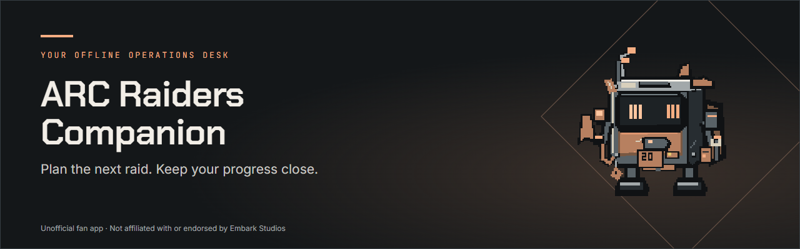
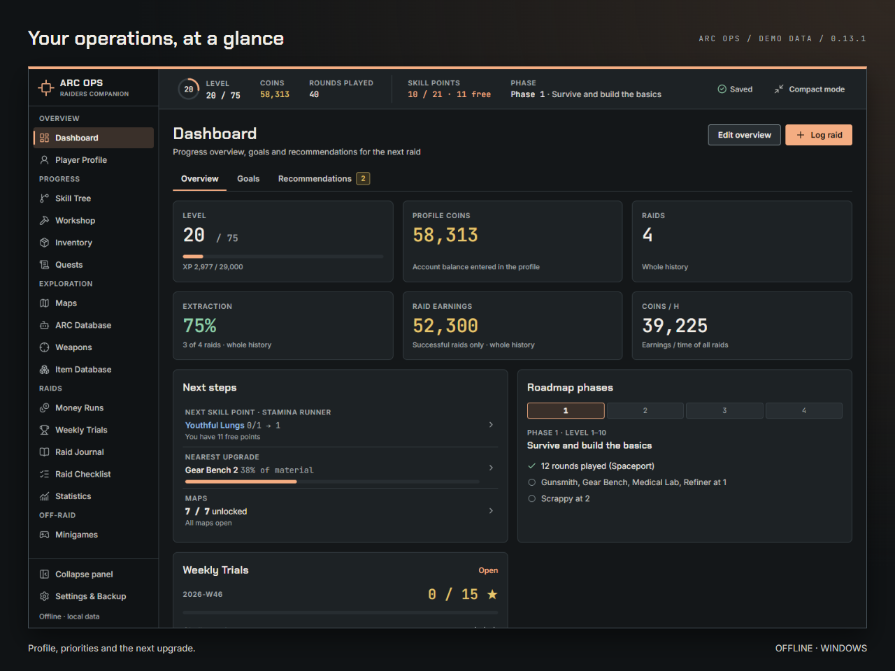
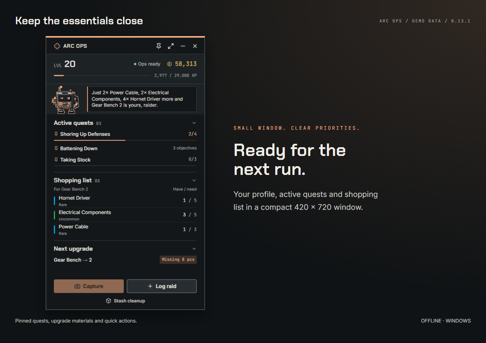
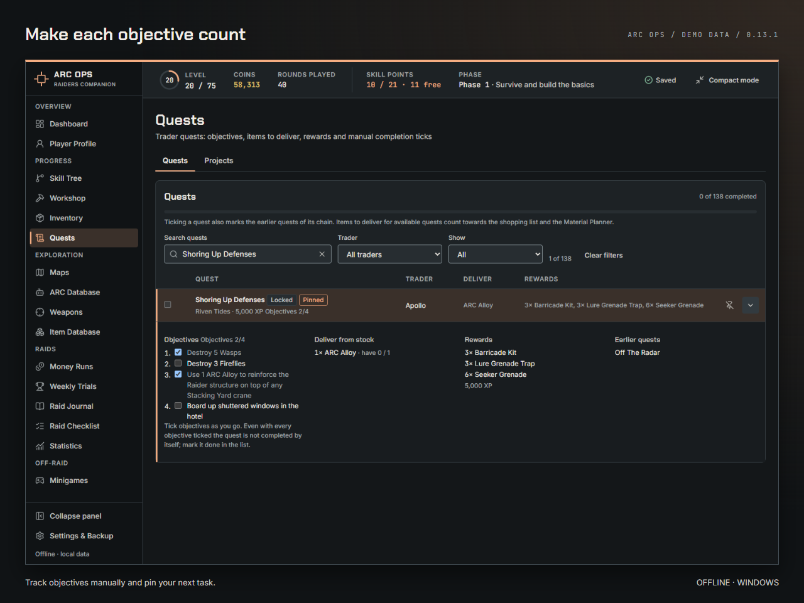
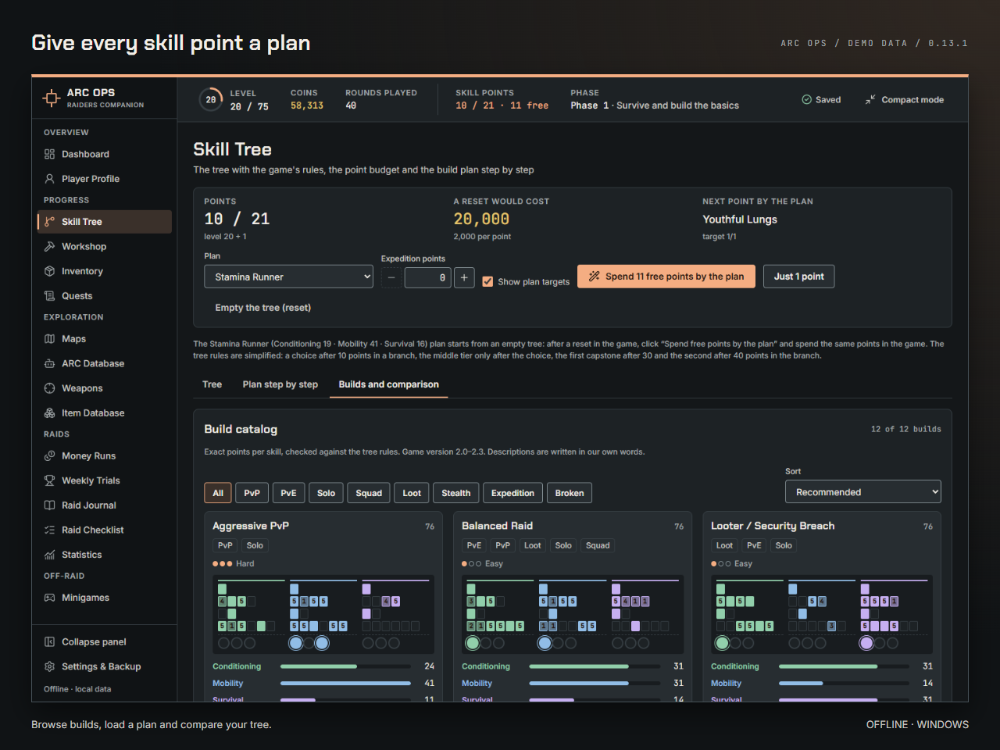
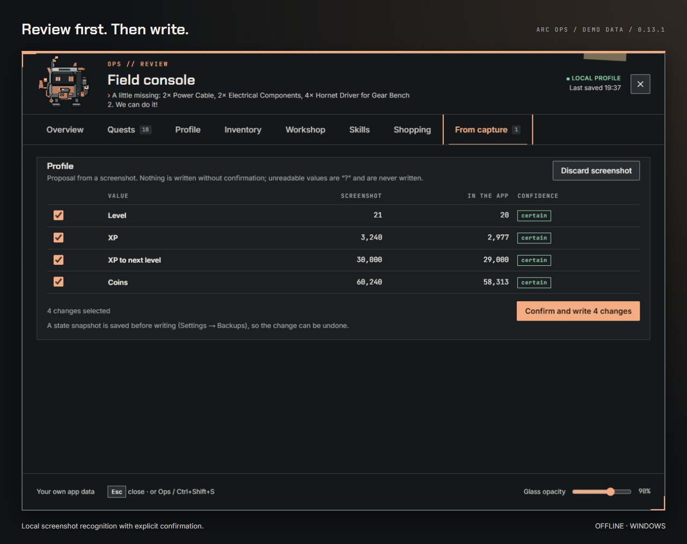
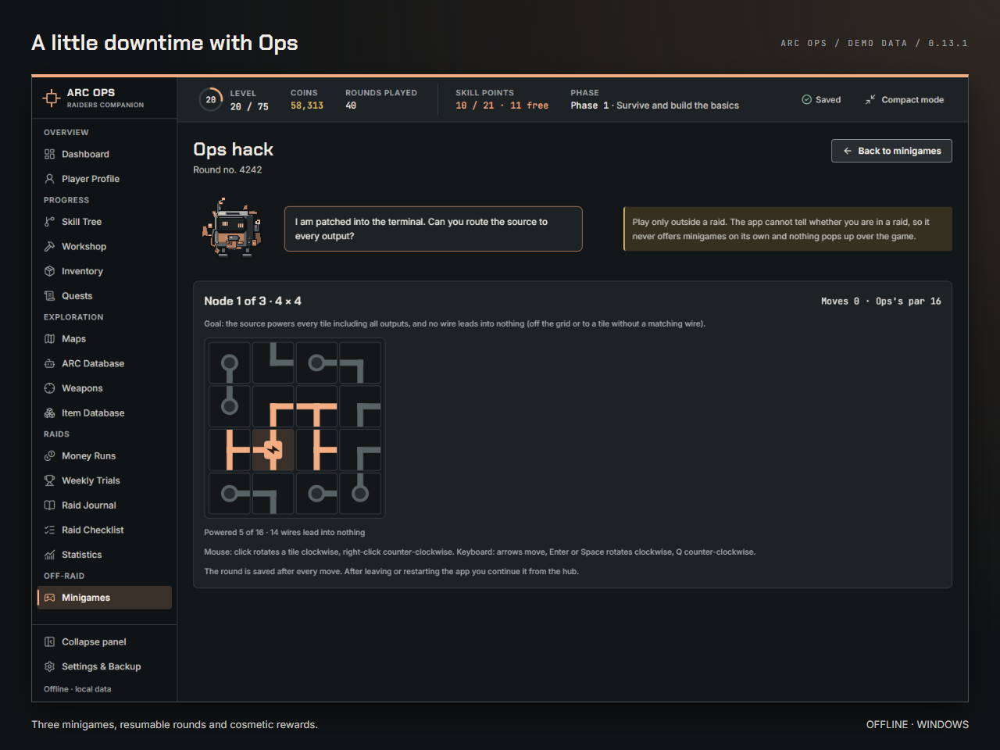
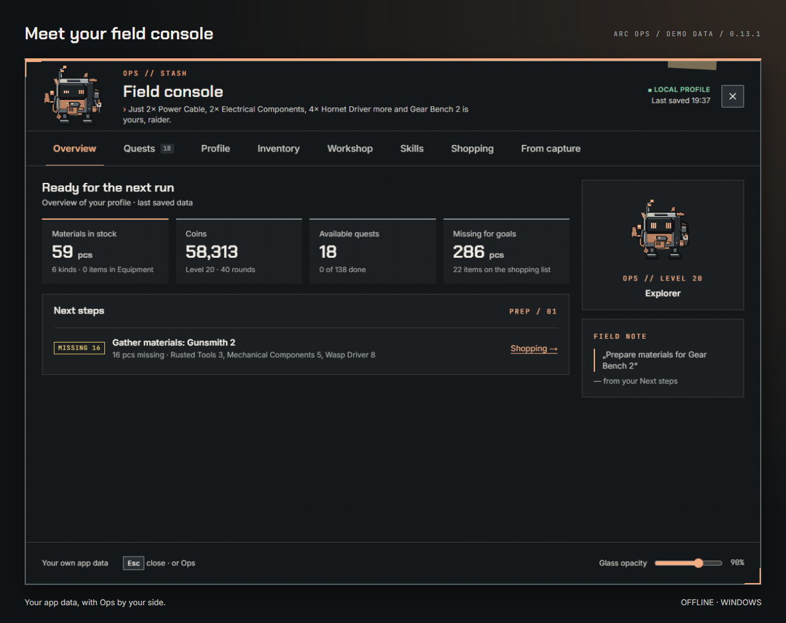

<picture>
  <source media="(prefers-color-scheme: light)" srcset="docs/assets/github/hero-light.png">
  
</picture>

# ARC Raiders Companion

[English](README.md) · [Instalace](#instalace) · [Historie verzí](CHANGELOG.md) · [Vývoj](DEVELOPMENT.md)

**0.13.1 · Windows · Offline · MIT · Česky a anglicky**

Osobní operační centrum pro hráče ARC Raiders. Zásoba, vylepšení dílny, cíle úkolů a plány skillů na jednom místě. To nejdůležitější si nech v kompaktním okně nebo ve volitelné polní konzoli Opse. Údaje ze snímků se čtou lokálně a před zápisem je vždy zkontroluješ. Mezi raidy si odpočiň u miniher s Bedňákem. Bez přihlášení, předplatného a cloudové synchronizace.

**Neoficiální fanouškovský projekt. Není spojen s Embark Studios ani jím schválen.**

## Co umí

Všechny obrázky ukazují demo data z prohlížečového sestavení, bez herních snímků. Nativní okna, zkratky a efekty Windows se v prohlížeči liší.

| Plánování a postup | Po ruce |
|---|---|
| **Přehled:** profil, další kroky, dílna a nákupní seznam. | **Kompakt:** připnuté úkoly, mám/potřebuji, rychlé akce. |
|  |  |
| **Úkoly:** ruční cíle a projekty; všechny cíle hotové neznamená automaticky splněný úkol. | **Buildy:** 12 plánů, vlastní buildy a porovnání se stromem; teorie je označená. |
|  |  |
| **Revize snímků:** jistota údajů, výslovné potvrzení, snímek stavu před zápisem. | **Minihry:** Stash Tetris, recyklační kvíz, Opsův hack, rozehraná kola a kosmetické nátěry. |
|  |  |

### Bedňák / Ops

Volitelný pixelový buddy s podobami podle levelu, animacemi, nátěry a třemi povahami. Kliknutím otevřeš konzoli s profilem, úkoly, zásobou, dílnou, skilly, nákupy a revizí snímku. Výchozí stav buddyho je **vypnuto**.

Navíc: rady pro úklid stashe, recyklace, blueprinty, porovnání zbraní, vlastní tier list, deník raidů, statistiky, checklisty a export/obnova JSON záloh. Herní data mohou za aktualizacemi zaostávat.

## Instalace

1. Použij **NSIS instalátor pro Windows** (`.exe`) dodaný správcem projektu. Vydané instalátory hledej v [Releases](https://github.com/sudo-rtkit/arc-ops/releases). Pokud tam zatím nejsou, můžeš aplikaci [sestavit ze zdrojů](DEVELOPMENT.md#run-and-check); místní sestavení uloží instalátor do `src-tauri/target/release/bundle/nsis/`.
2. Instaluj se zavřenou hrou nebo s hrou v **okně bez okraje (borderless)**. Další okno nad exkluzivní celou obrazovkou může hře vzít fokus.
3. Spusť aplikaci a nastav profil. Výchozí jazyk je čeština; angličtinu přepneš v Settings & Backup.
4. Buddyho a zkratku zapni v Nastavení jen podle potřeby.

Novou verzi instaluj přes stávající instalaci; data zůstanou. Před aktualizací exportuj JSON zálohu. Instalátor aplikaci sám nespouští; při spuštění za běžící hry se aplikace otevře minimalizovaná bez fokusu.

## Soukromí a bezpečnost

Vše funguje offline, bez přihlášení, telemetrie a odesílání na server. Externí odkazy se otevírají na přání. Snímky se zpracují lokálně a neukládají se jako obrázky; nativní snímek zkratkou zůstává jen v paměti. Uložit se mohou potvrzené údaje a číselné otisky ikon.

Aplikace nečte paměť hry, nevkládá do ní kód, neupravuje herní soubory a neposílá vstup. Volitelné otevření s hrou sleduje název procesu a stav okna včetně popředí. Změny ze snímků potvrzuje hráč, před zápisem vzniká snímek stavu. Rady nikdy samy nic neprodávají ani nemažou ve hře.

## Časté otázky

**Synchronizuje se postup s účtem?** Ne. Údaje zadáváš ručně nebo kontroluješ import snímku. Aplikace nezná živý stav raidu.

**Musí být hra anglicky?** Pro rozpoznávání snímků ano. Samotnou aplikaci můžeš používat česky i anglicky.

**Přečte každý snímek?** Ne. Podporované obrazovky mají omezení a nejisté údaje je nutné ověřit. Z přehledu skillů se neodvozují jednotlivé ranky.

**Je použití schválené Embarkem?** Ne. Netvrdíme schválení ani záruku vůči anti-cheatu. Řiď se vlastním úsudkem a aktuálními pravidly hry.

**Kam s chybou?** Do [Issues](https://github.com/sudo-rtkit/arc-ops/issues), s verzí a postupem reprodukce. Přílohy zbav osobních údajů.

## Neoficiální projekt

Nezávislý fanouškovský nástroj, bez spojení, sponzorství nebo schválení Embark Studios. ARC Raiders a související názvy patří příslušným vlastníkům; název pouze určuje hru, pro kterou je nástroj určen.

## Vývoj a licence

Tauri 2, React 19, TypeScript a čisté CSS. [Vývoj a překlady](DEVELOPMENT.md), [historie verzí](CHANGELOG.md), [technické návrhy](docs/superpowers/specs/).

[MIT](LICENSE). Písma mají vlastní OFL oznámení. Bedňák je původní grafika projektu.
