<picture>
  <source media="(prefers-color-scheme: light)" srcset="docs/assets/github/hero-light.png">
  <source media="(prefers-color-scheme: dark)" srcset="docs/assets/github/hero-dark.png">
  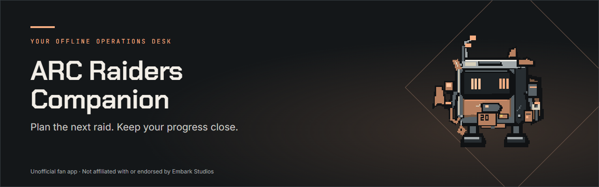
</picture>

# ARC Raiders Companion

[Česky](README.cs.md) · [Install on Windows](#install-on-windows) · [Changelog](CHANGELOG.md) · [Development](DEVELOPMENT.md)

Your offline operations desk for ARC Raiders. Keep your stash, workshop upgrades, quest objectives and skill plans together, then take the essentials into a compact window or the optional Ops field console. Review locally recognised screenshot data before writing any changes. Between raids, spend a little downtime with Bedňák — your customisable pixel-art buddy. No account login, no cloud sync, no subscription.

**Unofficial fan app. Not affiliated with or endorsed by Embark Studios.**

## A clearer plan for the next run

All views below use **demo data** from the browser build. The desktop app provides native windows, hotkeys and optional capture; Windows glass effects are not shown here.

<table>
<tr>
<td width="50%">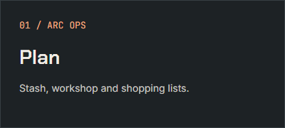 <b>Your operations desk</b> Profile, priorities, raid records, workshop upgrades and material shopping lists. <a href="docs/assets/github/dashboard@2x.png">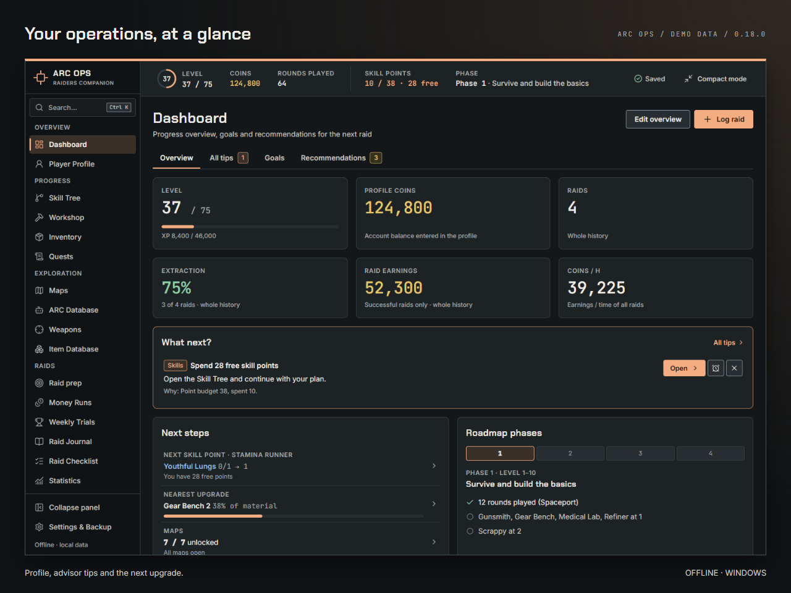</a></td>
<td width="50%">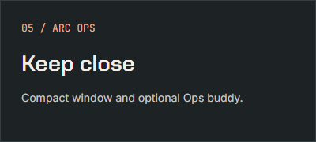 <b>A smaller window</b> Pin quests, see have/need counts and jump to raid logging or stash cleanup. <a href="docs/assets/github/compact@2x.png">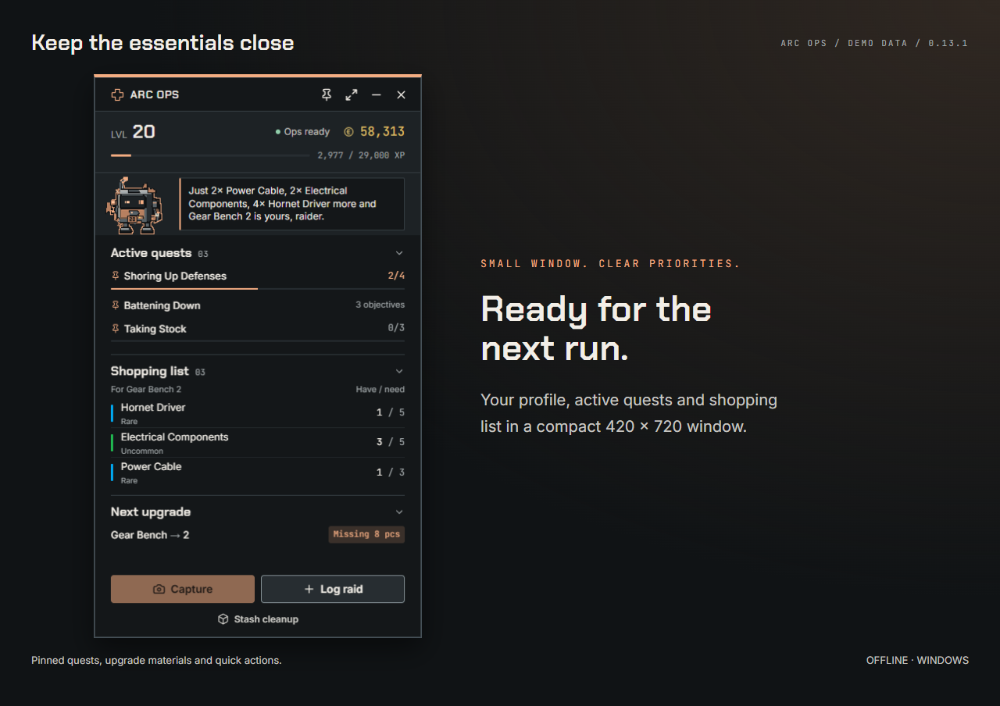</a></td>
</tr>
<tr>
<td>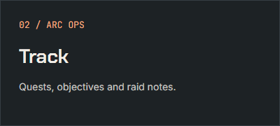 <b>One objective at a time</b> Check quest objectives, pin tasks and track seasonal projects. Checking every objective does not automatically complete the quest. <a href="docs/assets/github/quests@2x.png">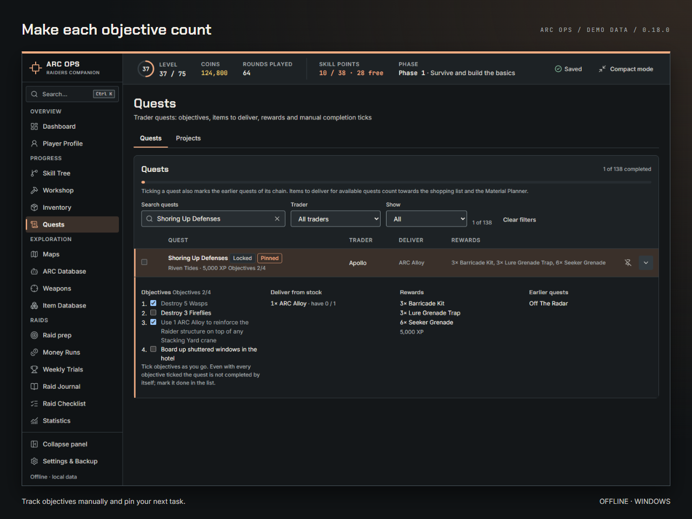</a></td>
<td>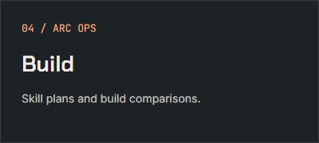 <b>Make your skill points count</b> Browse 12 builds, load a plan, save your own and compare with your current tree. Theory builds are labelled. <a href="docs/assets/github/builds@2x.png">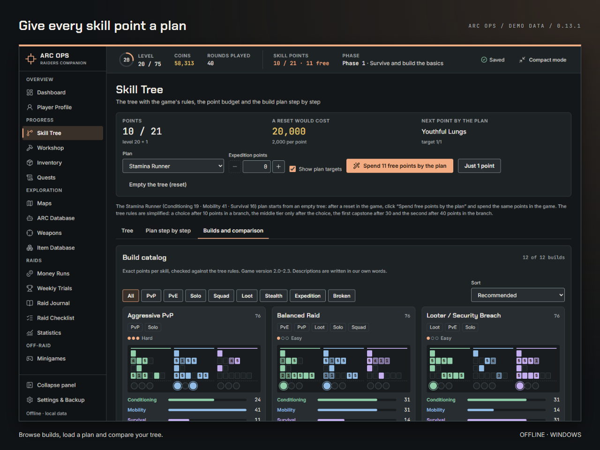</a></td>
</tr>
<tr>
<td>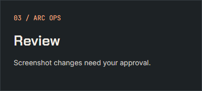 <b>You approve every import</b> Local recognition for supported inventory, loot and progression screens. Review confidence and changes; a state snapshot is saved before writing. <a href="docs/assets/github/import-review@2x.png">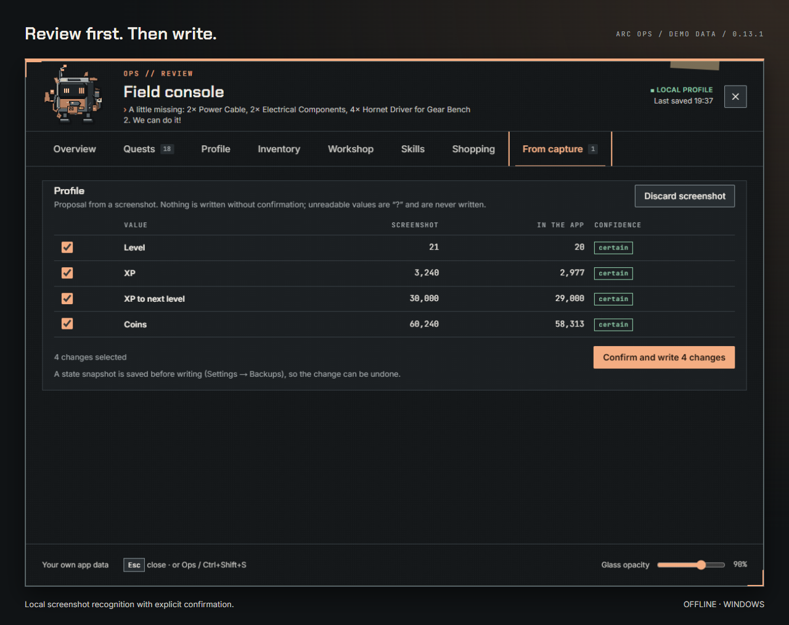</a></td>
<td>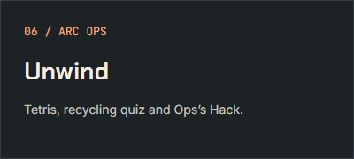 <b>A break with Ops</b> Stash Tetris, a recycling quiz and Ops’s Hack. Resume saved rounds and unlock cosmetic paints; rewards do not change game progress. <a href="docs/assets/github/minigames@2x.png">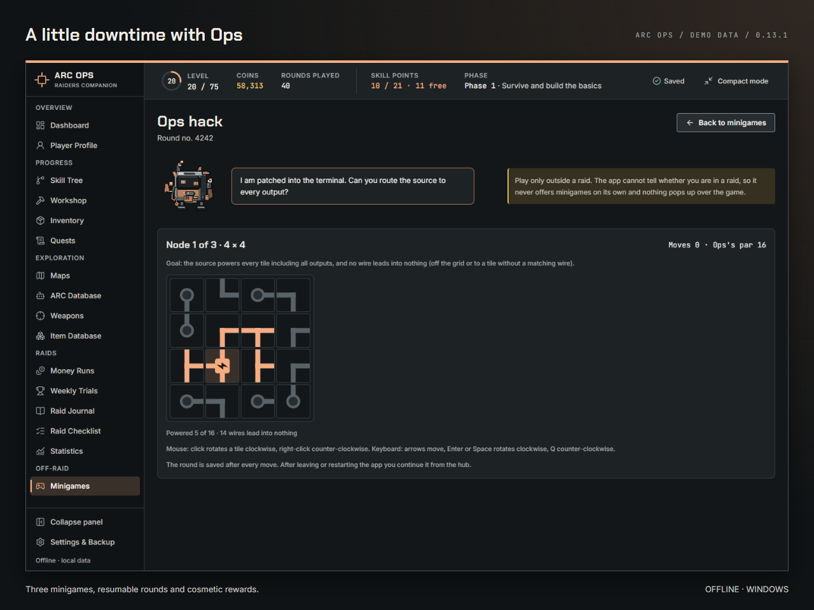</a></td>
</tr>
</table>

### What next?

The Dashboard's **What next?** card ranks your next best actions from your own data: an upgrade you can build now, a raid to evaluate, a pinned quest ready to hand in, free skill points, unfinished Weekly Trials, a full stash, an old backup or a goal that is due. Each tip says why, opens the right module in one click and can be hidden until its condition changes or snoozed for a day. The top tip also shows in the compact window and the field console, and Ops says it in your chosen personality while you use them, never over the game.

| Active plan: goals, materials and map reasons | Interactive map: points and plan highlights |
|---|---|
| [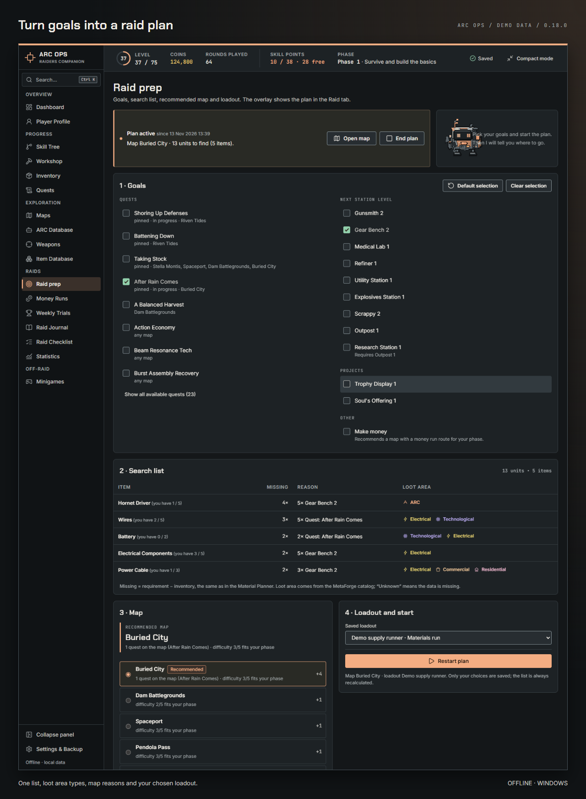](docs/assets/github/raid-prep@2x.png) | [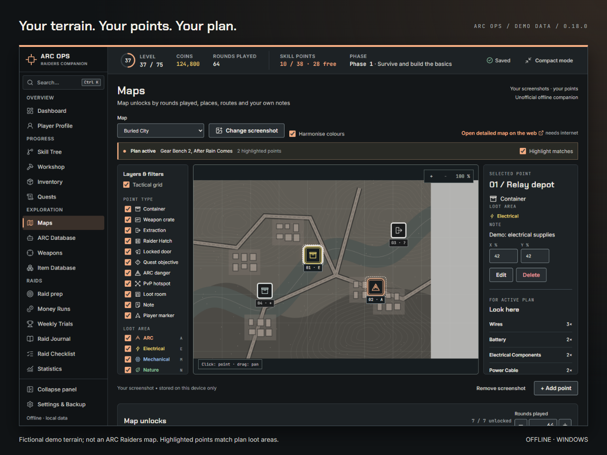](docs/assets/github/interactive-map@2x.png) |

The terrain shown here is fictional project artwork, standing in for a player-provided screenshot. It is not a game or community map. You choose the map and loadout.

| Raid tab: finds and item advice | After the raid: found, missing and upgrade ready |
|---|---|
| [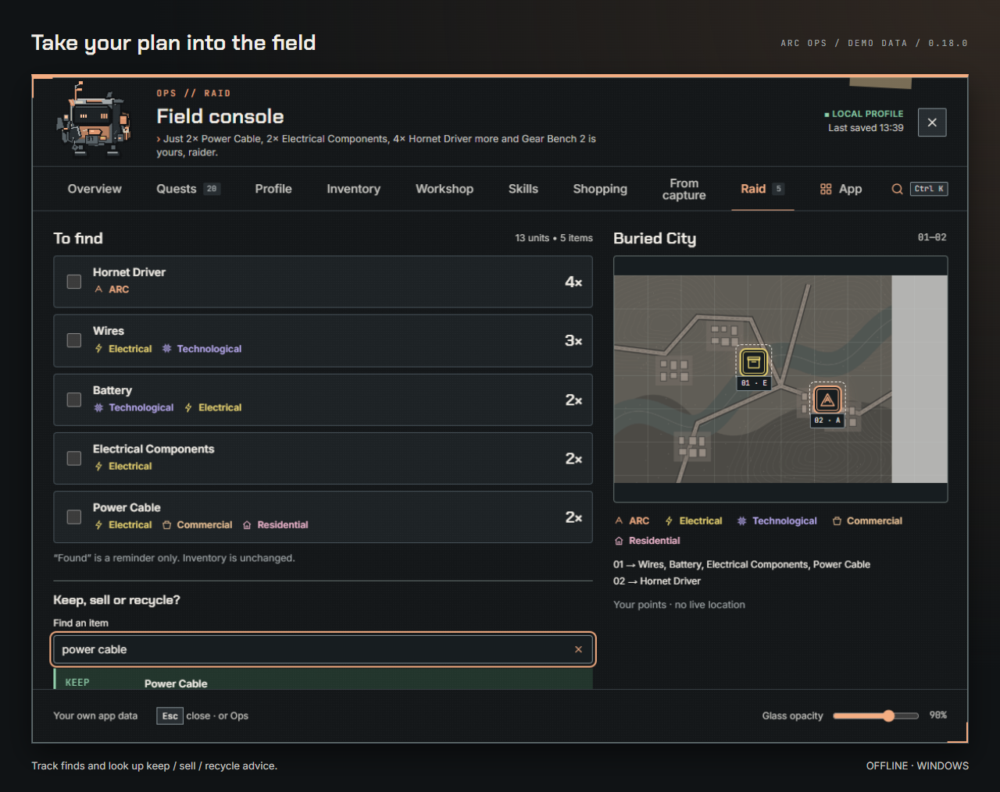](docs/assets/github/overlay-raid@2x.png) | [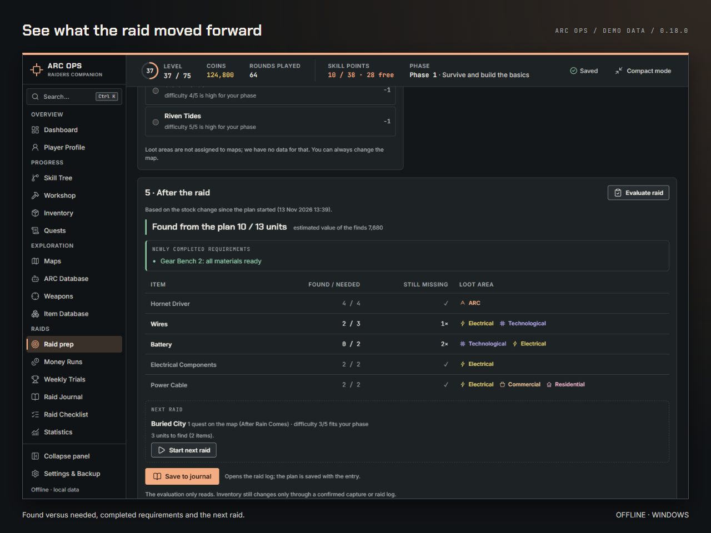](docs/assets/github/post-raid@2x.png) |

Plan history stays with entries in the Raid Journal. Statistics show which maps help with your goals; fewer than three planned raids are labelled “little data”.

### Search everywhere and “Why do I need this?”

Press **Ctrl+K** (or use the sidebar search) to find any item, quest, station, skill, build, map, module, setting or tip, in Czech or English, accents and small typos forgiven. An item opens its card: rarity, value, weight and stack, your stock, where it is needed (quests, stations, projects, your goals, the active raid plan) with what is still missing, what it recycles into and what recycles into it, where to look and which of your map points match, and the keep / recycle / sell verdict with its reason. Item names across the app open the same card, in the main window and in the field console.

| Ctrl+K: grouped search results | Item card: why you need it |
|---|---|
| [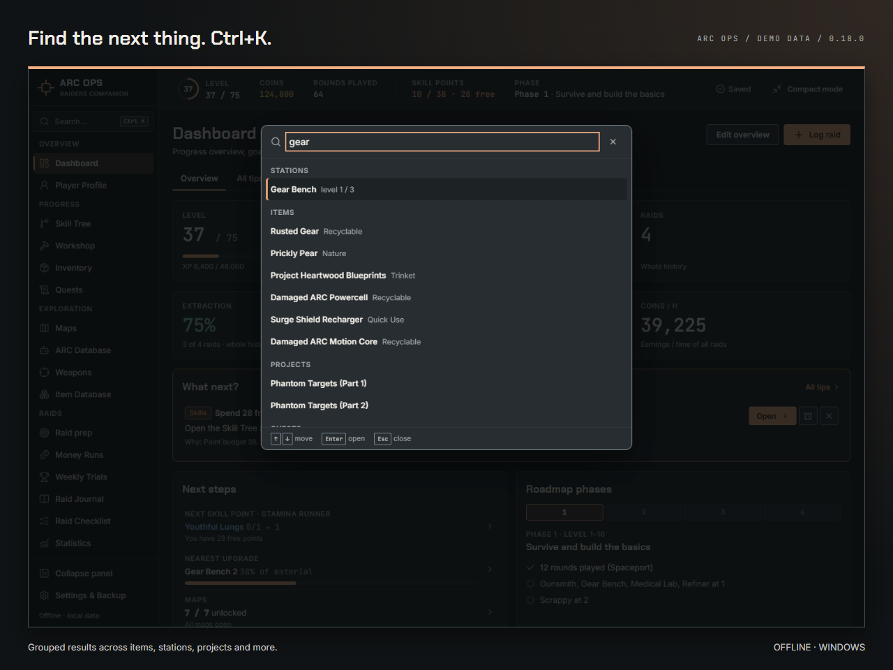](docs/assets/github/search@2x.png) | [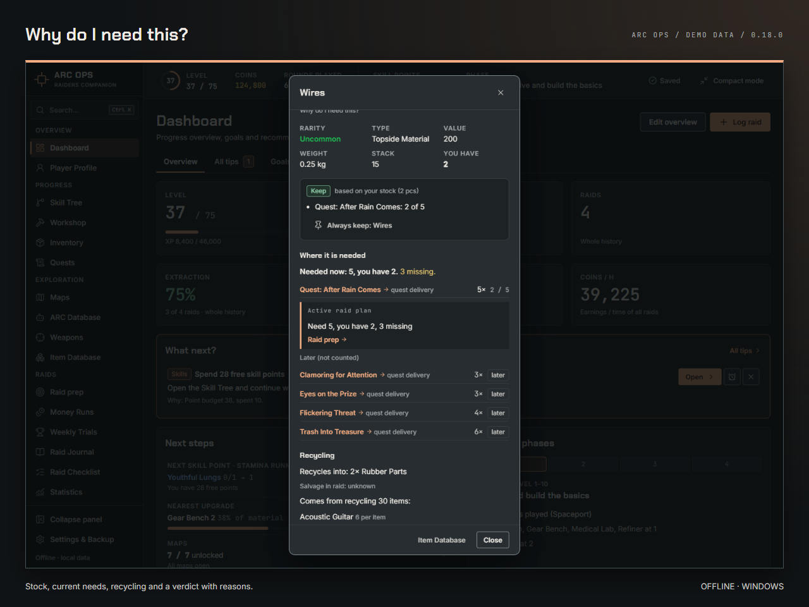](docs/assets/github/item-card@2x.png) |

Ctrl+K works while the app or overlay has focus. It is a local window shortcut. The card also shows matching points on your own map; missing catalogue facts stay unknown.

### Meet Bedňák, callsign Ops

An optional, draggable desktop buddy with level-based outfits, paints, animations and three personalities. Click Ops to open the field console: profile, quests, inventory, workshop, skills, shopping, capture review and the active raid plan. The **App** button opens any full module (skill tree, recipes, item database, maps, journal, statistics, minigames…) in a larger panel over the game; settings and backups stay in the main window. Buddy features start **off** and can be enabled in Settings.

**Where every value came from.** A small dot next to a stock count, a profile field, a station level, a skill rank or a quest objective tells you its origin on hover: entered manually, read from a screenshot (file or hotkey), from automatic capture or from a backup import, when, with what recognition confidence, and whether you confirmed it. Settings → Data origin summarises it per area with the recent writes, and the item card has an “Origin” line. When your stock has not changed for over a week and you have open goals, “What next?” suggests a STASH screenshot.

**Automatic capture of out-of-raid screens (optional, off by default, pending Embark review).** If you turn it on in Settings (after a short explanation), Ops watches only while the game is in the foreground: about every 2 s it copies a small strip with the screen title, and only on a known menu screen (loadout prep, raid result, and the screens you pick) does it take one full capture. Captures stay in memory and are discarded after reading. From the loadout and the result it drafts a Raid Journal entry: certain fields are written with a state snapshot and an Undo, uncertain ones wait in a “To review” queue. You can pause it from the compact window or the tray menu, and “Turn off all game connections” turns off the buddy over the game, the capture hotkey and automatic capture at once. Exclusive fullscreen may give black captures; borderless window mode is recommended. You enable it at your own discretion.

**Widgets over the game (0.22.0, optional, off by default, pending Embark review).** Pick small cards with your own data and place them over the game: To find (your raid plan), Pinned quests, Shopping, What next?, Keep / sell / recycle, Stash capacity, Weekly challenges, Ops, To review and Automatic capture. No map, position or minimap. In **Play** the widgets only display: the transparent window lets every click through to the game and never takes focus. Click Ops (or press your Edit shortcut) to enter **Edit**: drag and resize with an 8 px grid, edge and alignment snapping, set each widget's opacity (30–100 %, text always stays readable), density and lock, add widgets from the catalogue, undo, and switch between the **Lobby** and **Raid** layouts or your own with one click. Done or Esc returns to Play and gives focus back to the game. “Hide all” clears the screen for the session. **App** in Edit opens the full field console (all tabs and every full module). Layouts belong to this PC only: they are not in backups and a backup import never changes them. The game must run borderless or windowed; exclusive fullscreen is not supported.

[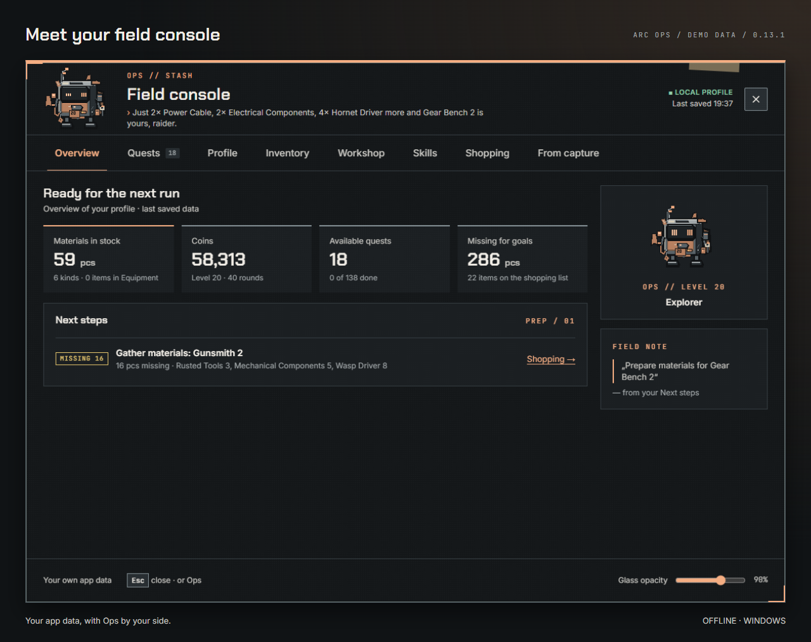](docs/assets/github/overlay@2x.png)

[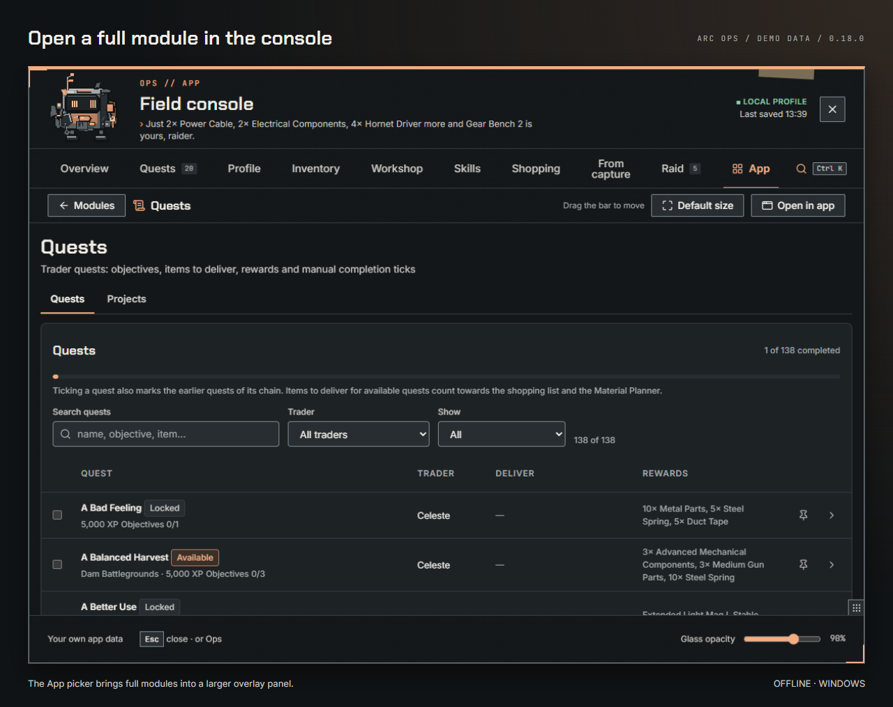](docs/assets/github/overlay-app@2x.png)

**Raid prep and your own map.** Pick goals (quests, the next station level, a project or money), get one list of what is still missing with the loot area from the item catalogue, a recommended map with its reasons, and the plan in the console's Raid tab with keep/sell/recycle lookups. The interactive map uses a screenshot of the in-game map that you add yourself; no game maps are bundled. Your points and plan highlights sit on top. After the raid, the plan is compared with what you found (from a confirmed FINDINGS capture or your stock change), shows what is still missing and which upgrades are ready, suggests the next raid and can be saved to the raid journal; statistics then show which maps help with your goals.

Also included: stash cleanup advice, item recycling references, blueprints, weapon comparison, a personal tier list, raid journal, statistics, checklists and local JSON backup/restore. Data references may lag game updates; you can adjust supported data inside the app.

## Install on Windows

1. Use the Windows **NSIS installer** (`.exe`) supplied by the maintainer. For published installers, check [Releases](https://github.com/sudo-rtkit/arc-ops/releases); if no release assets are available, follow the [build instructions](DEVELOPMENT.md#run-and-check). Local builds place the installer in `src-tauri/target/release/bundle/nsis/`.
2. Install with the game closed, or use the game's **borderless window** mode. Opening another window over exclusive fullscreen can take focus from the game.
3. Launch Companion, choose Czech or English in **Settings & Backup**, and set up your profile. Czech is the default language.
4. Enable Ops and choose a capture hotkey only if you want those features.

For an upgrade, use the newer installer over the existing installation; local data is retained. Export a JSON backup in Settings before upgrading. The installer does not launch the app automatically. If the game is already running, the app starts minimised without taking focus.

## Your data stays with you

- Works offline with no account login, telemetry or cloud upload. Nothing is sent to a server by the app; external source links open only when you choose them.
- Inventory, loot and progression screenshots are processed locally. Native hotkey capture stays in memory and is discarded after reading; imported screenshot images are not saved. Map screenshots you add yourself are stored only on this device and go into a backup only if you choose. Learned numeric icon fingerprints and confirmed values may be stored locally.
- No game-memory access, code injection, game-file modification or automated game input. Optional “open with game” checks process names and window visibility/foreground status; it does not open the game process for memory access.
- Recognition proposes changes; you review and confirm them. Unreadable fields stay unknown. State snapshots and JSON export/restore help you recover from mistakes.
- Stash advice never sells, recycles or deletes anything in the game.

Security hardening in 0.16.1 added per-window permissions, validated messages between windows and image-size limits. See the [release notes](CHANGELOG.md#0161--security-hardening) for details.

## FAQ

**Does this sync with my game account?** No. Enter data manually or review supported screenshots. The app has no account connection and cannot know your live raid state.

**Can I use Czech in the app?** Yes — Czech is the default, English is available in Settings. Screenshot recognition expects the **game UI in English**. Item and skill names retain their game names.

**Will every screenshot work?** No. Recognition supports specific screens and may be uncertain, especially at smaller resolutions. Check every proposal. Skill overview totals are informational; individual skill ranks come from tooltips.

**Is this approved for use by Embark or guaranteed safe from anti-cheat action?** No endorsement or such guarantee is claimed. The app stays outside game memory and does not send input to the game. Use your own judgement and the game's current rules.

**Does it include game artwork or maps?** This presentation uses original Ops artwork and demo app UI. No game screenshots, game artwork or Embark logos are included in these assets.

**How do I report a problem?** Open a [GitHub issue](https://github.com/sudo-rtkit/arc-ops/issues). Include the app version and reproduction steps; remove personal information from any attachments.

## Unofficial project

ARC Raiders Companion is an independent, unofficial fan project. It is not affiliated with, sponsored by, or endorsed by Embark Studios. ARC Raiders and related names belong to their respective owners. The name is used only to identify the game this tool accompanies.

## Development

Built with Tauri 2, React 19, TypeScript and plain CSS. See [DEVELOPMENT.md](DEVELOPMENT.md) for setup, checks, architecture and translation rules; [CHANGELOG.md](CHANGELOG.md) for release history; and the [design specifications](docs/superpowers/specs/) for technical context.

## Licence

[MIT](LICENSE). Bundled fonts retain their SIL Open Font License notices. Ops / Bedňák is the project's original artwork.
